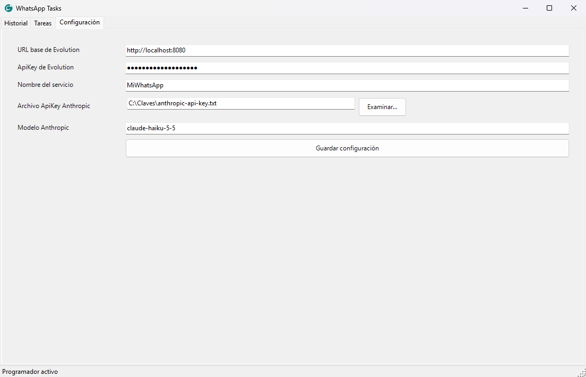
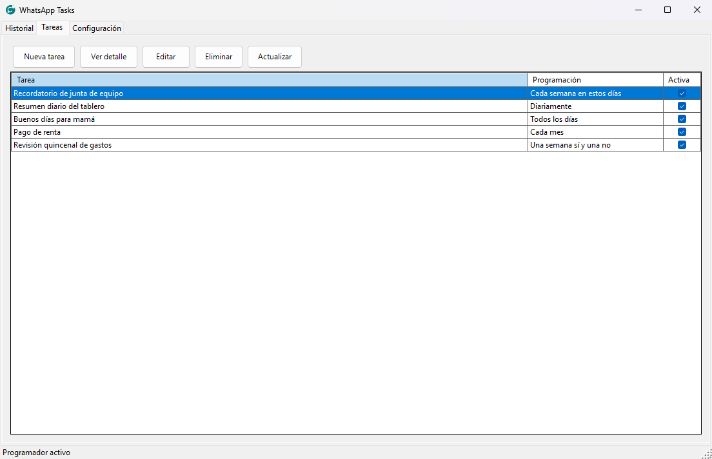

# WhatsApp Tareas

Un programa para **Windows** que envía mensajes de WhatsApp **solos, a la hora que tú elijas**.

Ejemplos de lo que puedes hacer:

- Mandar "Buenos días, la junta es a las 9" todos los días de lunes a viernes.
- Programar mensajes para un teléfono o un grupo de WhatsApp y suspender tareas cuando lo necesites.
- Que una inteligencia artificial (IA) escriba cada día un mensaje distinto para tu mamá, tu equipo o tus clientes, **sin que parezca escrito por una IA**.
- Que la IA consulte una página web o tu tablero de trabajo, haga un **resumen** y te lo mande por WhatsApp a las 9:00.

Para que funcione necesitas tres piezas, y esta guía te lleva de la mano con cada una:

```
 Este programa  ──►  Evolution API (en Docker)  ──►  Tu WhatsApp
 (WhatsApp Tareas)   el "puente" con WhatsApp         (se vincula con un QR)
```

> **Guía rápida de lectura:** los pasos 1 a 7 de abajo son la instalación (unos 20-30 minutos la primera vez).
> Los ejemplos de uso, con capturas de pantalla, están en **[docs/EJEMPLOS.md](docs/EJEMPLOS.md)**.

---

## Qué necesitas antes de empezar

| Qué | Para qué | Dónde conseguirlo |
| --- | --- | --- |
| Una computadora con **Windows 10 u 11** | El programa es solo para Windows | — |
| **Docker Desktop** | Levanta el "puente" con WhatsApp | <https://www.docker.com/products/docker-desktop/> |
| **SDK de .NET 10** | Convierte el código en un programa que puedes abrir | <https://dotnet.microsoft.com/download/dotnet/10.0> (elige "SDK") |
| **Git** (opcional) | Descargar el proyecto con un comando | <https://git-scm.com/downloads> |
| Un celular con **WhatsApp** | Será el WhatsApp desde el que se envían los mensajes | — |
| *(Opcional)* Una **clave de Anthropic** | Solo si quieres que la IA escriba mensajes | <https://console.anthropic.com/> |
| *(Opcional)* **Claude Code** | Solo para las tareas "Agente" (resúmenes de páginas, etc.) | <https://docs.claude.com/en/docs/claude-code/overview> |

Sin las dos últimas filas el programa funciona igual para mensajes de texto fijos.

---

## Paso 1. Descarga el proyecto

Abre **PowerShell** (tecla Windows, escribe `PowerShell`, Enter) y ejecuta:

```powershell
git clone https://github.com/wlnaim/neto-whatsapptasks.git
cd neto-whatsapptasks
```

Si no usas Git: en la página de GitHub pulsa el botón verde **Code → Download ZIP**, descomprime la carpeta y abre PowerShell dentro de ella.

---

## Paso 2. Crea tu propia clave de Evolution (tu "apikey")

Evolution es el programa que habla con WhatsApp. Se protege con una **clave que inventas tú**. Nadie más debe conocerla, porque con ella se pueden mandar mensajes desde tu WhatsApp.

1. Copia la plantilla de configuración:

   ```powershell
   Copy-Item .env.example .env
   ```

2. Genera una clave larga y aleatoria. Ejecuta esto y **copia el resultado** (son letras y números mezclados):

   ```powershell
   $b = New-Object byte[] 32; (New-Object Security.Cryptography.RNGCryptoServiceProvider).GetBytes($b); -join ($b | ForEach-Object { $_.ToString('x2') })
   ```

3. Abre el archivo **.env** con el Bloc de notas (`notepad .env`) y cambia los dos valores:

   ```
   EVOLUTION_API_KEY=pega-aqui-la-clave-que-acabas-de-generar
   EVOLUTION_DB_PASSWORD=otra-contrasena-solo-con-letras-y-numeros
   ```

   - `EVOLUTION_API_KEY` es **tu apikey de Evolution**. Pega la que generaste.
   - `EVOLUTION_DB_PASSWORD` es la contraseña de la base de datos interna. Genera otra con el mismo comando. Debe tener **solo letras y números**, sin símbolos ni espacios.
   - Sin espacios ni comillas alrededor del `=`.

4. Guarda y cierra. **Apunta tu clave en un lugar seguro**: la vas a necesitar en el paso 6.

> El archivo `.env` es privado y está en `.gitignore`, así que Git no lo sube a GitHub. **Nunca lo compartas ni lo copies a un chat.**
>
> ¿Quieres cambiar la clave más adelante? Edita `EVOLUTION_API_KEY` en `.env`, ejecuta `docker compose up -d` otra vez (recrea el contenedor con la clave nueva) y actualiza la clave en la pestaña **Configuración** del programa.

---

## Paso 3. Enciende Evolution con Docker

1. Abre **Docker Desktop** y espera a que diga que está corriendo (la ballena abajo a la izquierda queda en verde).
2. En PowerShell, dentro de la carpeta del proyecto:

   ```powershell
   docker compose up -d
   ```

   La primera vez descarga unos cientos de MB y tarda algunos minutos. El archivo [docker-compose.yml](docker-compose.yml) levanta tres contenedores: **Evolution API**, **Postgres** (su base de datos) y **Redis** (su memoria rápida).

3. Comprueba que está vivo: abre <http://localhost:8080> en tu navegador. Debe aparecer algo como:

   ```
   {"status":200,"message":"Welcome to the Evolution API, it is working!","version":"2.3.7",...}
   ```

   Si no abre, espera medio minuto y recarga.

---

## Paso 4. Vincula tu WhatsApp (escanear el QR)

1. Abre el panel: <http://localhost:8080/manager/>
2. Te pide dos datos:
   - **Server URL:** `http://localhost:8080`
   - **API Key Global:** la clave que pusiste en `.env` (paso 2).
3. Crea una instancia nueva (botón de **nueva instancia**; los nombres de los botones pueden variar un poco):
   - **Name:** un nombre sencillo sin espacios, por ejemplo `MiWhatsApp`. **Apúntalo**, lo usarás en el paso 6.
   - **Integration:** `WHATSAPP-BAILEYS`
4. Aparece un código **QR**. En tu celular: **WhatsApp → Ajustes → Dispositivos vinculados → Vincular un dispositivo** y escanea el QR.
5. Cuando la instancia muestre el estado **open** (conectada), listo.

¿Prefieres la terminal? Estos comandos hacen lo mismo (cambia `TU_CLAVE`):

```powershell
curl.exe -X POST http://localhost:8080/instance/create -H "apikey: TU_CLAVE" -H "Content-Type: application/json" -d "{\"instanceName\":\"MiWhatsApp\",\"qrcode\":true,\"integration\":\"WHATSAPP-BAILEYS\"}"
curl.exe -H "apikey: TU_CLAVE" http://localhost:8080/instance/connectionState/MiWhatsApp
```

El segundo comando debe responder `"state":"open"` cuando WhatsApp está vinculado.

---

## Paso 5. Crea el programa

En PowerShell, dentro de la carpeta del proyecto:

```powershell
./Publish.ps1
```

Si Windows se queja de que no se pueden ejecutar scripts, usa en su lugar:

```powershell
powershell -ExecutionPolicy Bypass -File .\Publish.ps1
```

Al terminar tendrás la carpeta **publish** con el programa `WhatsAppTasks.App.exe`. **No muevas el .exe solo**: déjalo junto a los demás archivos de esa carpeta.

---

## Paso 6. Abre el programa y configúralo

1. Abre `publish\WhatsAppTasks.App.exe`. El programa se queda **escondido junto al reloj de Windows** (puede estar dentro de la flechita `^` de iconos ocultos). Haz doble clic en el icono verde con reloj, o clic derecho → **Mostrar Interfaz**.
2. Entra a la pestaña **Configuración** y llena:

   | Campo | Qué poner |
   | --- | --- |
   | URL base de Evolution | `http://localhost:8080` |
   | ApiKey de Evolution | La clave de tu archivo `.env` (paso 2) |
   | Nombre del servicio | El nombre de tu instancia (paso 4), por ejemplo `MiWhatsApp` |
   | Archivo ApiKey Anthropic | *(Solo si usarás IA)* ruta de un archivo `.txt` que contenga únicamente tu clave de Anthropic, guardado **fuera** de esta carpeta |
   | Modelo Anthropic | `claude-haiku-5-5` (rápido y barato; puedes cambiarlo por otro modelo de tu cuenta) |
   | Máximo de caracteres por mensaje | `300` inicialmente; puedes guardar otro entero positivo |

   

3. Pulsa **Guardar configuración**. La clave de Evolution se guarda cifrada con tu usuario de Windows.

---

## Paso 7. Tu primera tarea de prueba

1. Pestaña **Tareas → Nueva tarea**.
2. Llena:
   - **Nombre:** `Prueba`
   - **Código de país:** por ejemplo `52` (México). Solo números.
   - **Número telefónico:** tu propio número, solo dígitos, sin espacios ni signos. Si Evolution responde que el número "no existe" (HTTP 400 / `exists: false`), revisa el código de país y el formato; en México algunos números requieren un `1` entre el `52` y los 10 dígitos.
   - **Calendarización:** `Una sola vez`, con una fecha de hoy y una hora **2 o 3 minutos en el futuro**. Marca la casilla de la hora.
   - **Tipo de mensaje:** `Mensaje fijo`, escribe `Hola, esta es una prueba`.
3. **Guardar**. Espera la hora: llegará el WhatsApp y aparecerá en la pestaña **Historial**.



> **Importante:** el programa y la computadora deben estar **encendidos** a la hora del envío. Si estaban apagados o suspendidos, ese envío se **omite** (no se manda tarde). Para cerrar el programa de verdad usa clic derecho en el icono del reloj → **Salir**; la X de la ventana solo la oculta.

¿Ya funcionó? Pasa a **[docs/EJEMPLOS.md](docs/EJEMPLOS.md)**: calendarizaciones, mensajes con IA que suenan humanos y resúmenes automáticos de páginas web.

---

## Por qué usamos exactamente la versión 2.3.7 de Evolution

En [docker-compose.yml](docker-compose.yml) la imagen es `evoapicloud/evolution-api:v2.3.7`, no `latest`. Razones:

1. **Es la última versión estable.** Las versiones más nuevas (2.4.x) están publicadas como pruebas (*pre-release*) y, según sus notas, piden activar una licencia; sin ella pueden fallar con error 503.
2. **Evita sorpresas.** Con `latest`, un día cualquiera Docker descargaría una versión distinta y tu programa podría dejar de funcionar sin que cambiaras nada. Una versión fija siempre se comporta igual.
3. **Es con la que se probó este programa.** Las rutas que usa (enviar texto, estado de conexión) corresponden a esta versión; el envío es `POST /message/sendText/{instancia}` con el encabezado `apikey`.
4. **Ya incluye el panel web** (`/manager`), así que no necesitas un contenedor extra.
5. **La imagen correcta:** la antigua `atendai/evolution-api` dejó de mantenerse; hoy la oficial es `evoapicloud/evolution-api`.

Para actualizar en el futuro: lee las notas de la versión nueva, haz una copia de seguridad de tus datos, cambia el número de versión en `docker-compose.yml` y ejecuta `docker compose pull` y luego `docker compose up -d`. Para volver atrás, regresa el número anterior (una versión nueva pudo haber modificado la base de datos).

---

## Comandos útiles de Docker

```powershell
docker compose ps          # ver si todo está corriendo
docker compose logs -f evolution-api   # ver mensajes del puente (Ctrl+C para salir)
docker compose down        # apagar SIN perder tu WhatsApp vinculado
docker compose up -d       # volver a encender
```

Cuidado: `docker compose down -v` **borra los datos** y tendrás que escanear el QR otra vez.

---

## Problemas comunes

| Síntoma | Qué revisar |
| --- | --- |
| `Falta EVOLUTION_API_KEY en el archivo .env` | No creaste el `.env` (paso 2) o está vacío. |
| <http://localhost:8080> no abre | Docker Desktop no está corriendo, o aún está arrancando. Revisa `docker compose ps`. |
| El puerto 8080 ya está ocupado | Otro programa lo usa. Cierra ese programa o cambia `8080:8080` por `8082:8080` en `docker-compose.yml` y usa `http://localhost:8082` en el programa. |
| El mensaje sale como **Fallida** (HTTP 401) | La clave en **Configuración** no coincide con la de `.env`. |
| Fallida con HTTP 400 / `exists: false` | El código de país o el número están mal, o ese número no tiene WhatsApp. |
| Fallida y la instancia no está `open` | WhatsApp se desvinculó: vuelve a escanear el QR (paso 4). |
| No pasa nada a la hora indicada | El programa estaba cerrado o la PC suspendida. Revisa que el icono siga junto al reloj. |

En la pestaña **Historial**, clic derecho sobre un envío fallido → **Reintentar** (solo envía las partes que faltaron).

---

## Seguridad y uso responsable

- Evolution **no es un producto oficial de WhatsApp**: funciona como WhatsApp Web. Úsalo con tu propio número y para mensajes legítimos. El envío masivo o no solicitado (spam) puede hacer que WhatsApp **bloquee tu número**.
- Tu clave de Evolution y tu clave de Anthropic son como contraseñas: nunca las pongas en el repositorio, capturas de pantalla ni chats.
- El puerto 8080 está abierto **solo para tu computadora** (`127.0.0.1`). No lo expongas a internet.
- Las tareas tipo **Agente** ejecutan Claude Code en tu equipo con las herramientas que le permitas. Dale solo las necesarias; lo que responda se enviará por WhatsApp tal cual.

---

## Suspensión, grupos y tamaño de mensajes

En la barra de acciones del listado de tareas se ofrece **Suspender** para tareas activas y **Habilitar** para tareas suspendidas. La suspensión conserva la configuración y dura hasta habilitarla manualmente; los envíos vencidos se omiten.

El destinatario puede ser **Teléfono** o **Grupo**. Primero usa **Configuración → Cargar catálogo de grupos** y luego selecciona el grupo por nombre en el editor. El identificador completo del grupo se envía sin añadir código de país. Actualizar el catálogo reemplaza su contenido local con los grupos válidos. Los grupos sin nombre o con datos inválidos se omiten, y la ventana muestra cuántos se importaron y cuántos se descartaron. Si la respuesta válida está vacía o todos sus grupos se omiten, el catálogo local queda vacío. Un fallo de conexión, una respuesta ilegible o un error de almacenamiento conserva el catálogo anterior. Las tareas guardadas conservan su grupo aunque deje de aparecer en el catálogo.

En **Configuración** puedes cambiar el máximo de caracteres por mensaje para nuevas ejecuciones (300 inicialmente). Cada ejecución guarda el tamaño utilizado: sus reintentos conservan las mismas partes aunque después cambie el valor global. La pausa entre partes sigue siendo de cinco segundos. Los pares Unicode se conservan completos; un emoji de dos unidades UTF-16 permanece unido incluso con límite 1.

## Registro de errores

La aplicación crea una carpeta **Logs junto a `WhatsAppTasks.App.exe`**, incluso si se usa una ubicación distinta para la base de datos. Registra el inicio, los errores de la interfaz, los envíos, el programador y las etapas de sincronización de grupos. El aviso de error muestra la ruta y un identificador para localizar el intento correspondiente.

Los archivos usan formato JSONL, rotación por tamaño y una retención máxima de siete días. Los diagnósticos evitan guardar claves, mensajes, prompts, nombres de grupos, identificadores completos y respuestas del servidor. Las omisiones de grupos incluyen un motivo y su posición en la respuesta.

Los logs y las bases de datos son archivos locales de uso: no deben añadirse a Git ni compartirse públicamente. Si se solicita un diagnóstico, revisa primero su contenido y comparte únicamente lo necesario.

## Más información técnica

- Cómo funcionan el historial, los reintentos, la división de mensajes largos y el agente: **[docs/REFERENCIA.md](docs/REFERENCIA.md)**.
- Para desarrolladores: `dotnet build WhatsAppTasks.slnx -c Release` y `dotnet test WhatsAppTasks.slnx -c Release`. Las pruebas usan datos temporales y HTTP simulado: no mandan mensajes reales ni gastan saldo de Anthropic.

## Licencia

GPL-3.0. Consulta el archivo [LICENSE](LICENSE).
