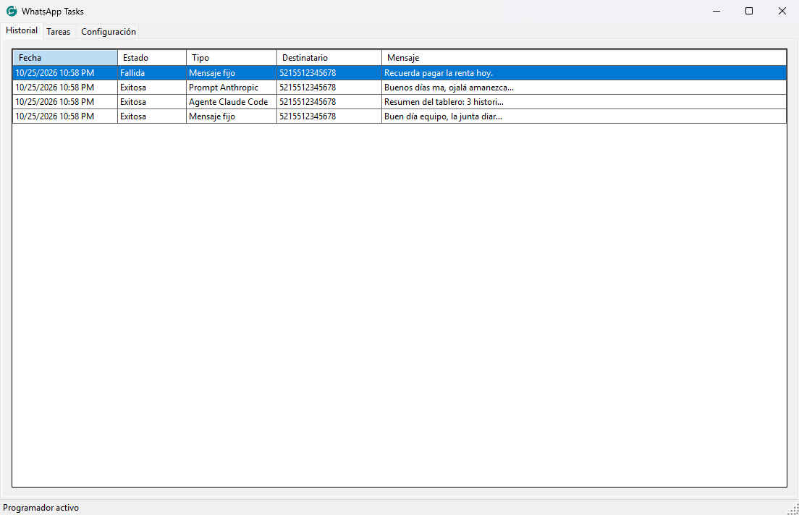
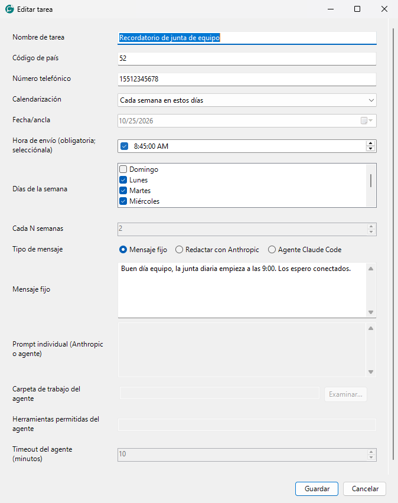
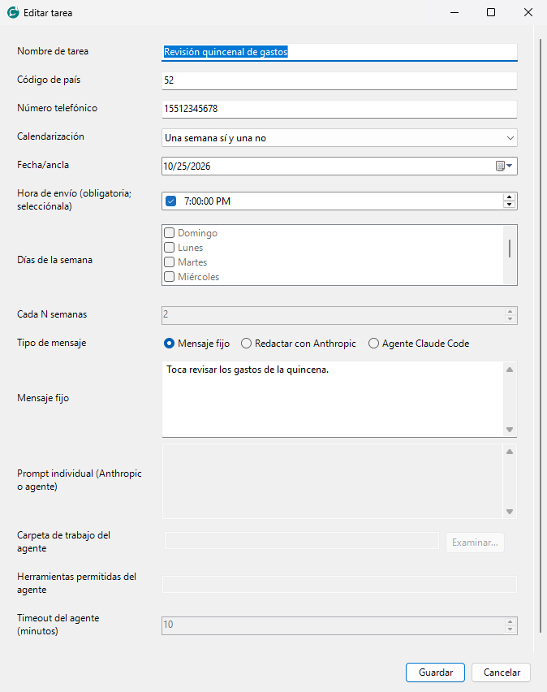
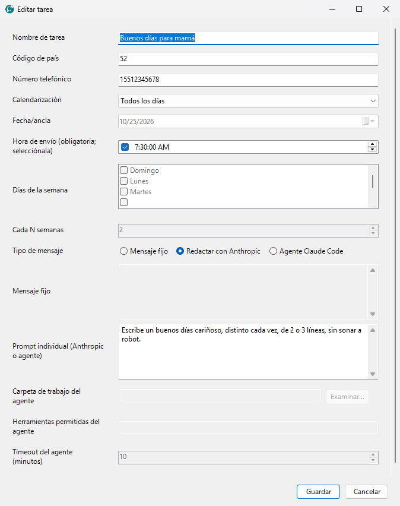
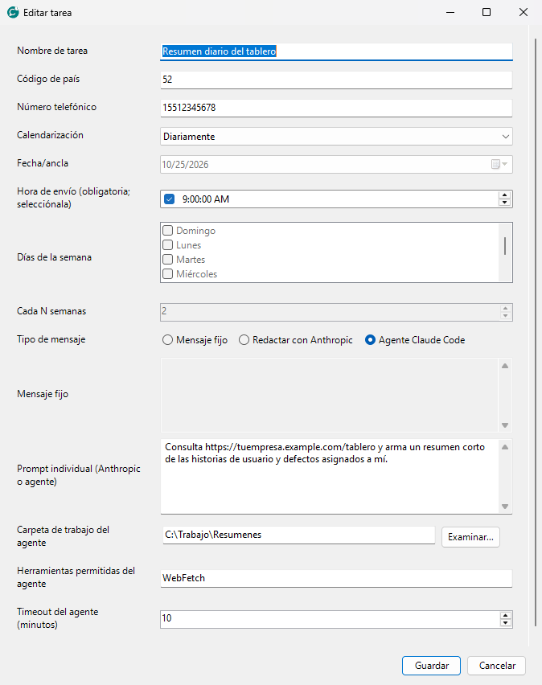

# Ejemplos de uso

Esta guía supone que ya terminaste la instalación del [README](../README.md) y que tu primera tarea de prueba funcionó. Todos los nombres, números y direcciones de los ejemplos son inventados: cámbialos por los tuyos.

**Contenido**

1. [Cómo se ve el programa](#1-cómo-se-ve-el-programa)
2. [Ejemplo 1: mensaje fijo (el más sencillo)](#2-ejemplo-1-mensaje-fijo)
3. [Tipos de calendarización](#3-tipos-de-calendarización)
4. [Ejemplo 2: mensajes distintos escritos por IA que no parecen de IA](#4-ejemplo-2-mensajes-distintos-escritos-por-ia)
5. [Ejemplo 3: consultar una página o tablero, hacer un resumen y enviarlo](#5-ejemplo-3-consultar-una-url-y-enviar-un-resumen)
6. [Cuál tipo de mensaje elegir](#6-cuál-tipo-de-mensaje-elegir)

---

## 1. Cómo se ve el programa

Tiene tres pestañas:

| Pestaña | Para qué sirve |
| --- | --- |
| **Historial** | Qué se envió, a quién y si salió bien o falló (últimas 48 horas). |
| **Tareas** | Crear, ver, editar y eliminar tus envíos programados. |
| **Configuración** | Datos de Evolution (tu WhatsApp) y de Anthropic (la IA). |

**Historial**: doble clic en una fila para ver el mensaje completo; clic derecho en una fila fallida → **Reintentar**.



**Tareas**: aquí viven tus envíos programados. Pulsa **Nueva tarea** para crear uno.


Cada tarea tiene **un solo destinatario**. Para escribirle a varias personas, crea una tarea por persona (puedes copiar los mismos datos y cambiar el número).

---

## 2. Ejemplo 1: mensaje fijo

Un texto escrito por ti que se envía igual cada vez. Ideal para recordatorios.

**Objetivo:** recordar la junta diaria a un compañero, de lunes a viernes a las 8:45.

1. **Tareas → Nueva tarea**.
2. Llena:
   - **Nombre:** `Recordatorio de junta de equipo`
   - **Código de país / Número:** el de tu compañero (solo dígitos).
   - **Calendarización:** `Cada semana en estos días` y marca **Lunes** a **Viernes**.
   - **Hora de envío:** `8:45 AM` (hay que marcar la casilla de la hora).
   - **Tipo de mensaje:** `Mensaje fijo`.
   - **Mensaje fijo:** `Buen día, la junta diaria empieza a las 9:00. Los espero conectados.`
3. **Guardar**.



> Los mensajes de más de 300 caracteres se envían automáticamente en varias partes, con 5 segundos entre una y otra, para que no lleguen como un bloque enorme.

---

## 3. Tipos de calendarización

El campo **Calendarización** ofrece estas opciones. La hora siempre se elige en **Hora de envío** y se usa la hora de tu computadora.

| Opción | Cuándo se envía | Ejemplo |
| --- | --- | --- |
| **Una sola vez** | Una fecha y hora exactas (deben ser futuras). | Felicitar a alguien el 14 de marzo a las 8:00. |
| **Fecha futura** | Igual que la anterior, pero la fecha debe ser posterior a hoy. | Recordar un trámite dentro de dos meses. |
| **Diariamente** / **Todos los días** | Todos los días a la hora indicada. | "Buenos días" a las 7:30. |
| **Cada semana en estos días** | Los días de la semana que marques. | Lunes, miércoles y viernes a las 18:00. |
| **Cada mes** | El mismo día del mes que la **Fecha/ancla**. Si el mes no tiene ese día (por ejemplo el 31), se manda el último día del mes. | Pago de renta el día 1 a las 10:00. |
| **Una semana sí y una no** | Cada dos semanas, empezando en la **Fecha/ancla**. | Revisión de gastos quincenal. |
| **Cada N semanas** | Cada N semanas (tú eliges N) el mismo día de la semana que la **Fecha/ancla**. | Cada 3 semanas, los martes. |

**La "Fecha/ancla"** es la fecha de arranque: la semana o el día que se toma como punto de partida para contar. Se usa en *Una sola vez, Fecha futura, Cada mes, Una semana sí y una no* y *Cada N semanas*.

Ejemplo de **Una semana sí y una no** (se ve en la lista de tareas como "Una semana sí y una no"):



Recuerda: si la computadora o el programa estaban apagados a la hora de envío, **ese envío se omite** y la tarea sigue con su siguiente fecha.

---

## 4. Ejemplo 2: mensajes distintos escritos por IA

En vez de un texto fijo, le das a la IA un **prompt** (una instrucción) y ella escribe el mensaje **cada vez que se ejecuta la tarea**. Así cada envío sale diferente.

**Requisitos:** haber configurado el archivo con tu clave de Anthropic (README, paso 6).

**Objetivo:** un buenos días distinto cada mañana para tu mamá, a las 7:30.

1. **Tareas → Nueva tarea**.
2. **Calendarización:** `Todos los días`, **Hora:** `7:30 AM`.
3. **Tipo de mensaje:** `Redactar con Anthropic`.
4. **Prompt individual:** el texto de abajo.
5. **Guardar**.



### Prompt de ejemplo

```
Eres yo, Carlos, escribiéndole a mi mamá por WhatsApp. Escribe un buenos días
de 2 o 3 líneas. Cada vez debe ser distinto: a veces pregunta cómo amaneció,
a veces comenta el clima o algo cotidiano, a veces desea buen día sin más.
Habla de "tú", con cariño y en tono natural de México. Sin emojis, o máximo uno.
No uses saludos de carta ni frases hechas de tarjeta. Responde SOLO con el
texto del mensaje, sin comillas ni explicaciones.
```

### Cómo lograr que no parezca escrito por una IA

La IA hace lo que le pides, así que dile **cómo hablas tú**. Estos consejos funcionan:

| Consejo | Por qué ayuda |
| --- | --- |
| Dile **quién eres y a quién le escribes** ("soy Carlos, le escribo a mi mamá"). | El tono cambia por completo entre mamá, jefe o cliente. |
| Pide **mensajes cortos** ("2 o 3 líneas"). | Las IA tienden a escribir de más; las personas, no. |
| Prohíbe lo típico: "Estimado", "Espero que te encuentres bien", listas, negritas, muchos emojis. | Son las marcas más obvias. |
| Pide **variedad explícita** ("cada vez distinto: a veces pregunta..., a veces comenta..."). | Evita que todos los días suene igual. |
| Define el **tono** ("de tú", "con modismos de México", "relajado"). | Suena a tu forma real de hablar. |
| Pega **2 o 3 mensajes tuyos reales** como modelo ("imita este estilo: ..."). | Es lo más efectivo. |
| Termina con **"Responde SOLO con el texto del mensaje"**. | Lo que responda la IA se envía tal cual; si agrega "Claro, aquí tienes:", llegará así. |

Otros ejemplos de prompts, cada uno en su propia tarea y con su propio destinatario:

**Felicitación de cumpleaños (una sola vez, el día del cumpleaños):**

```
Escribe una felicitación de cumpleaños para Ana, mi compañera de trabajo desde
hace 4 años. Tono cálido pero sin exagerar, 2 líneas, un solo emoji. No uses
"Querida" ni frases de tarjeta. Responde solo con el mensaje.
```

**Recordatorio amable de pago (cada mes, día 5) a un cliente:**

```
Soy diseñador freelance y le escribo a mi cliente Luis. Escribe un recordatorio
amable de que su factura del mes está pendiente. Máximo 3 líneas, cordial y
directo, sin sonar a cobranza ni a robot. Cambia las palabras cada vez.
Responde solo con el mensaje.
```

**Aviso al equipo, viernes 17:00:**

```
Escribe un mensaje corto para mi equipo cerrando la semana: agradece el trabajo
y recuerda subir sus horas antes del lunes. Tono informal de compañero, sin
formalidades, máximo 3 líneas, sin viñetas. Responde solo con el mensaje.
```

> **Importante:** este modo llama directo a la IA, que **no sabe qué día es ni puede consultar internet**. Si necesitas que use datos reales (la fecha, una página, tu tablero), usa el tipo **Agente Claude Code** del siguiente ejemplo.
>
> **Cuida lo que envías:** es buena idea probar el prompt primero con tu propio número antes de ponerlo con otra persona.

---

## 5. Ejemplo 3: consultar una URL y enviar un resumen

Con el tipo **Agente Claude Code**, la IA puede **usar herramientas**: abrir páginas web, ejecutar comandos, leer archivos... y luego redactar el mensaje con lo que encontró. Lo que el agente responde al final es lo que se manda por WhatsApp.

**Objetivo:** todos los días a las 9:00 recibir por WhatsApp un resumen corto de las historias de usuario y defectos que tienes asignados en tu tablero.

**Requisitos:**

- Tener **Claude Code** instalado y con sesión iniciada (verifica en PowerShell con `claude --version`). Instrucciones: <https://docs.claude.com/en/docs/claude-code/overview>
- Una carpeta de trabajo vacía para el agente, por ejemplo `C:\Trabajo\Resumenes`.

### Pasos

1. **Tareas → Nueva tarea**.
2. **Nombre:** `Resumen diario del tablero`. **Número:** el tuyo (así el resumen te llega a ti).
3. **Calendarización:** `Diariamente`, **Hora:** `9:00 AM`.
4. **Tipo de mensaje:** `Agente Claude Code`.
5. **Prompt:** el texto de abajo.
6. **Carpeta de trabajo del agente:** `C:\Trabajo\Resumenes`.
7. **Herramientas permitidas:** `WebFetch` (permite abrir páginas web; ver más abajo cuál poner según tu caso).
8. **Timeout:** `10` minutos (por defecto).
9. **Guardar**.



### Prompt de ejemplo

```
Abre https://tuempresa.example.com/tablero y revisa las historias de usuario y los
defectos asignados a Carlos. Arma un resumen para WhatsApp:
- Una línea de saludo.
- Cuántas historias en curso y cuántos defectos hay, destacando los críticos.
- Máximo 5 viñetas con "ID - título - estado".
No inventes datos: si no puedes abrir la página, responde exactamente
"No pude consultar el tablero". Máximo 800 caracteres, texto plano, sin tablas.
Responde SOLO con el texto del mensaje.
```

### ¿Qué herramientas permitidas pongo?

El campo se pasa a Claude Code (`--allowedTools`). Pon **solo lo necesario** y sepáralas con espacio o coma.

| Caso | Herramientas permitidas |
| --- | --- |
| Leer una página web pública | `WebFetch` |
| Consultar una API con `curl` | `Bash(curl:*)` |
| Tablero que pide inicio de sesión (Azure DevOps, Jira, GitHub...) y ya tienes su línea de comandos con sesión iniciada | Solo el comando que necesitas, por ejemplo `Bash(az boards:*)` o `Bash(gh issue list:*)` |
| Una herramienta de un servidor MCP que ya tienes configurado en Claude Code | `mcp__nombre_del_servidor__nombre_de_la_herramienta` |
| Leer archivos de la carpeta de trabajo | `Read` |

Ejemplo para un tablero que requiere sesión: inicia sesión **una vez** con la herramienta de línea de comandos de tu sistema (por ejemplo `az login` o `gh auth login`), pon en **Herramientas permitidas** `Bash(az boards:*)` y en el prompt indica qué consultar ("usa `az boards query` para traer mis defectos activos...").

### Cuidados importantes

- El agente se ejecuta **en tu computadora y con tus permisos**. Lo que permitas se hace **sin pedirte confirmación**. No pongas `Bash` suelto si no lo necesitas; limítalo a comandos concretos como `Bash(gh issue list:*)`.
- Una página web puede contener **texto malicioso** que intente darle órdenes a la IA. Por eso conviene dar pocas herramientas y no mandar el resumen a otras personas sin revisarlo antes.
- Prueba primero con tu propio número y revisa el resultado en **Historial**.
- Si el agente tarda más del timeout, la tarea queda fallida y **no se envía nada**.
- Un reintento desde el Historial reenvía el mensaje ya guardado, **no** vuelve a ejecutar al agente.

### Otras ideas con el agente

- "Resume los titulares de <https://sitio-de-noticias.example.com> y dime los 3 más importantes para mi industria" (viernes 8:00).
- "Revisa la carpeta con los reportes del día y dime qué archivos nuevos hay" (herramientas: `Read`, `Glob`).
- "Consulta el estado de mi sitio con `curl` y avísame solo si hay un error" (herramienta: `Bash(curl:*)`).

---

## 6. Cuál tipo de mensaje elegir

| Quiero... | Tipo | Necesita |
| --- | --- | --- |
| Enviar siempre el mismo texto | **Mensaje fijo** | Nada más |
| Un mensaje distinto y natural cada vez, sin datos externos | **Redactar con Anthropic** | Clave de Anthropic |
| Que la IA consulte páginas, comandos o archivos y resuma | **Agente Claude Code** | Claude Code instalado |

Siempre: prueba primero con tu número, y usa el programa para mensajes que la otra persona espera recibir.
